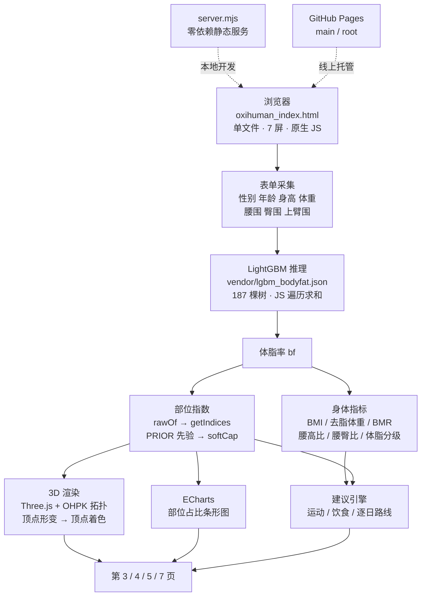
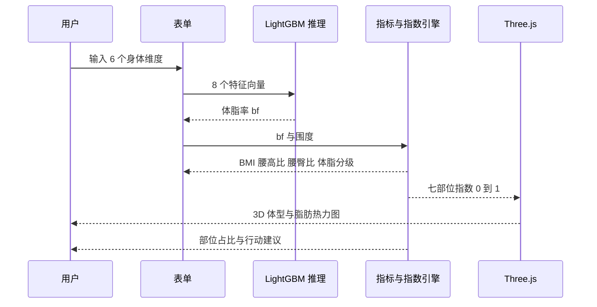

# OxiHuman · 智能体脂管家（LipoCare）

> 填 6 个身体维度，就能在浏览器里看到一具会「发胖」的 3D 人体 —— 脂肪厚度以热力图铺在皮肤上，配合部位占比、代谢风险比例与逐日行动路线。
> **全静态、零后端、离线可用**：体脂预测用的 LightGBM 模型以 82 KB JSON 内置在页面里，打开网页即完成推理。

[](https://hazelhu2005-blip.github.io/oxihuman-3d-viewer/)
[](https://threejs.org/)
[](https://lightgbm.readthedocs.io/)
[](#技术选型)

- 🌐 在线预览：<https://hazelhu2005-blip.github.io/oxihuman-3d-viewer/>
- 📦 仓库地址：<https://github.com/hazelhu2005-blip/oxihuman-3d-viewer>

---

## Overview (English)

**OxiHuman** is a fully static, browser-only body-fat visualization web app. Users enter six anthropometric measurements; a LightGBM model (187 trees, trained on 2,422 NHANES records, R² = 0.841) predicts body-fat percentage **entirely on the client side** — the exported tree ensemble is an 82 KB JSON file, so no server, no API key, and no network round-trip is required. The prediction drives a parametric Three.js human mesh whose skin is shaded by a per-region subcutaneous-fat heat map, alongside ECharts breakdowns of regional fat share, waist-to-height and waist-to-hip risk ratios, and a generated day-by-day action plan.

No bundler, no framework, no `npm install` needed to view: one HTML file plus local vendored libraries.

---

## 项目介绍

### 它解决什么问题

体脂秤只给一个数字，体检报告只给一行「体脂率偏高」。但**脂肪长在哪里，比长多少更影响健康** —— 同样的 25% 体脂，脂肪堆在腹部和堆在臀腿，代谢风险完全不同。

OxiHuman 把「一个数字」拆成三层可感知的信息：

1. **长什么样** —— 按你的真实围度重建 3D 体型，脂肪厚度直接热力着色，腹部厚还是大腿厚一眼可见；
2. **长在哪** —— 部位级脂肪占比（腹部 / 腰侧 / 臀部 / 上臂），只展示你真正量过的部位；
3. **该怎么办** —— 结合腰高比、腰臀比的代谢风险分级，给出运动、饮食与逐日路线。

### 七页流程

| 页 | 名称 | 内容 |
|---|---|---|
| 01 | 封面 | 项目定位与入口 |
| 02 | 选择评估方式 | 简单版 / 专业版二选一，填写身体维度 |
| 03 | 身体画像总览 | 体脂率、BMI、体重、去脂体重、身体年龄、BMR + **3D 体型与脂肪热力图** |
| 04 | 深度分析 | 各部位脂肪占比条形图、腰高比 / 腰臀比代谢风险卡 |
| 05 | 运动与饮食方向 | 依据体型与体脂分级生成行动建议 |
| 06 | 生活节奏访谈 | 采集作息、饮食、运动习惯 |
| 07 | 逐日健康路线 | 按访谈结果生成可执行的日程表 |

### 两种评估模式

| | 简单版 | 专业版 |
|---|---|---|
| 输入 | 性别、腰围 | 性别、年龄、身高、体重、腰围、臀围、上臂围 |
| 体脂来源 | 腰围回归公式 | **内置 LightGBM 模型**（8 特征） |
| 3D 体型 | 身高体重按 170cm / 65kg 模拟，页面明确标注 | 真实维度驱动 |
| 深度分析（第 4 页） | 跳过（缺少臀围与体重，无法算比例） | 完整展示 |

> 设计原则：**不把模拟值伪装成实测值**。简单版没有身高体重输入，结果页的体重与 BMI 卡片直接显示「数据不足」。

---

## 核心特性

- **纯浏览器推理**：LightGBM 树结构展平为数组，`lgbmPredict()` 逐棵遍历求和，亚毫秒级；JS 与 Python 推理最大误差 `4.8e-07`。
- **参数化 3D 人体**：OHPK 数据包提供基础拓扑，`morph.js` 按部位指数做顶点级形变，顶点色直接查脂肪色表 —— 不是贴图，是真的「长肉」。
- **解剖先验约束**：每个部位乘一套男女独立的基准权重（`PRIOR`），防止数据噪声把「腹部 > 下胸 > 大腿」的生理排序翻转。
- **上端软化**：指数逼近 1 用指数渐近（`softCap`）而非硬截断，极端体型之间仍保留高低次序。
- **口径统一**：模型体脂同时驱动 3D 热力图、第 3 页「优先关注」与第 4 页部位占比，三处不会互相打架。
- **优雅降级**：模型文件加载失败 → 回退旧本地接口 → 再回退线性公式，页面始终有结果。
- **零依赖服务**：`server.mjs` 只用 Node 内置模块，开箱即可本地预览。

---

## 技术架构

### 总体架构



### 分层说明

| 层 | 实现 | 关键文件 |
|---|---|---|
| 表现层 | 单文件 HTML + 内联 CSS/JS，7 个 `<section class="page">` 由 `go(n)` 切换，无框架、无构建 | `oxihuman_index.html` |
| 3D 渲染层 | Three.js `WebGLRenderer`；体积数据从 OHPK 包解析（`parseOhpk` / `extractBody` / `weldMesh`），`morph.js` 施加部位形变 | `vendor/three.module.js`、`ohpk.js`、`morph.js`、`oxihuman-core-v1.ohpk` |
| 推理层 | LightGBM 模型导出为扁平节点数组，`lgbm-flat-v1` 格式，纯 JS 遍历 | `vendor/lgbm_bodyfat.json` |
| 指标层 | 体脂 → 五处原始厚度 → 整体水平 `lev` × 局部偏离 `dev` × 解剖先验 `PRIOR` → `softCap` | `oxihuman_index.html` 内 `rawOf` / `getIndices` |
| 归因层 | 精确 Shapley：2⁵ 子集全枚举，`w = s!(n−s−1)!/n!`；目标量为七部位指数 | `shapContrib()` |
| 可视化层 | ECharts 横向条形图 + Canvas 色标条 | `vendor/echarts.min.js` |
| 交付层 | 零依赖 Node 静态服务器（本地）/ GitHub Pages（线上） | `server.mjs`、`index.html` |

### 数据流（一次提交发生什么）



### 技术选型

| 决策 | 做法 | 为什么 |
|---|---|---|
| **零后端** | 静态站点 + 模型 JSON 浏览器推理 | 任何人打开链接即用，无需部署算力，GitHub Pages 免费托管 |
| **单文件前端** | 830 KB HTML，内联样式与脚本 | 无打包链路，评审可直接读源码；改一处刷新即见效 |
| **模型扁平导出** | `[isLeaf, feature, threshold, left, right, leafValue]` | 几十行 JS 即可复现 Python 推理，不引入任何运行时依赖，仅 82 KB |
| **解剖先验** | 男女各一套部位基准权重 | 小样本下模型会给出违反生理常识的局部排序，先验兜底 |
| **上端渐进软化** | `softCap` 指数渐近 | 硬 `clamp` 会把 40% 和 55% 体脂压成同一个 1.000 |
| **口径单一** | 模型体脂贯穿三处展示 | 曾经出现线性公式与模型两套口径，导致第 3 / 4 页排序互相矛盾 |
| **依赖本地化** | Three.js / ECharts 放 `vendor/` | 不依赖 CDN，离线可用，版本可控 |

### 目录结构

仓库只保留运行网页所需的文件：

```
.
├── index.html                   # GitHub Pages 根路径跳转页
├── oxihuman_index.html          # 主入口：7 页应用（内联 CSS/JS）
├── ohpk.js                      # OHPK 几何数据包解析
├── morph.js                     # 部位形变（按部位指数改顶点）
├── oxihuman-core-v1.ohpk        # 3D 几何数据包（2.0 MB）
├── LipoCare-mark.png            # 品牌角标（页面唯一图片资源）
├── server.mjs                   # 零依赖本地静态服务器
├── package.json                 # npm start / npm run serve
├── README.md
└── vendor/                      # 前端依赖，已本地化，无需 npm install
    ├── three.module.js          #   Three.js WebGL 渲染引擎
    ├── echarts.min.js           #   ECharts 图表库
    └── lgbm_bodyfat.json        #   LightGBM 体脂模型（82 KB / 187 棵）
```

---

## 安装与运行

### 前置要求

| 项目 | 版本 | 说明 |
|---|---|---|
| 浏览器 | Chrome / Edge 最新版 | 必须支持 **WebGL** 与 ES Module |
| Node.js | ≥ 18（实测 22.22.2） | 仅用于本地静态服务；不装也能用 Python 起服务 |

> ⚠️ **不要双击 HTML 直接打开**。`file://` 协议下模型 JSON 会被 CORS 拦截，页面会停在「填写数据后生成身材示意」的状态。

### 方式一：Node（推荐）

`server.mjs` 只用 Node 内置模块，**无需 `npm install`**：

```bash
git clone https://github.com/hazelhu2005-blip/oxihuman-3d-viewer.git
cd oxihuman-3d-viewer

npm start                      # 等价于 node server.mjs
```

打开 <http://127.0.0.1:8080/oxihuman_index.html>

脚本会自动尝试 **8080 / 8081** 两个端口，被占用则跳到下一个；都占用时会提示你怎样换端口：

```bash
PORT=8090 node server.mjs            # macOS / Linux / Git Bash
$env:PORT=8090; node server.mjs      # Windows PowerShell
```

### 方式二：Python

```bash
python -m http.server 8000
```

打开 <http://localhost:8000/oxihuman_index.html>

> Python 的 `http.server` 对 `.ohpk` 返回的 MIME 是 `application/octet-stream` 以外的猜测量，少数浏览器会按错误类型处理。若 3D 模型不出现，优先用方式一。

### 方式三：GitHub Pages（无需安装）

直接访问 <https://hazelhu2005-blip.github.io/oxihuman-3d-viewer/>，根路径会自动跳转到 `oxihuman_index.html`。

---

## 环境配置

### 环境变量

前端是**纯静态**的，不读取任何环境变量 —— 它按相对路径加载 `vendor/` 与资产文件，换域名、换端口都无需改配置。唯一的环境变量由本地服务脚本使用：

| 变量 | 默认值 | 作用范围 | 说明 |
|---|---|---|---|
| `PORT` | `8080` | `server.mjs` | 本地服务主端口，脚本会同时尝试 `PORT+1` |

如需固定配置，可在仓库根新建 `.env`（已被 `.gitignore` 忽略）后：

```bash
node --env-file=.env server.mjs      # Node ≥ 20.6 原生支持，无需 dotenv
```

```dotenv
PORT=8080
```

### 依赖清单

**① 前端依赖（已随仓库提供，无需安装）**

| 文件 | 大小 | 用途 |
|---|---|---|
| `vendor/three.module.js` | 1.27 MB | Three.js WebGL 渲染引擎（ES Module） |
| `vendor/echarts.min.js` | 1.03 MB | ECharts 图表库 |
| `vendor/lgbm_bodyfat.json` | 82 KB | LightGBM 体脂模型（187 棵树） |

**② Node 端依赖（零第三方包）**

`server.mjs` 仅使用 `node:http` / `node:fs` / `node:net` / `node:path` / `node:url`；`package.json` 无 `dependencies`，克隆后直接 `npm start`。

**③ 运行时自检**

页面右上角显示「本地计算」时表示模型已在浏览器内加载成功。若想确认：

```js
// 打开页面后在控制台执行
window.__lgbm.state()   // → { ready: true, error: null, trees: 187 }
```

---

## 体脂模型

模型已训练完成并固化在 `vendor/lgbm_bodyfat.json`，**运行网页不需要 Python、不需要重新训练**。

| 指标 | 数值 |
|---|---|
| 特征 | 性别、年龄、身高、体重、BMI、腰围、臀围、上臂围（8 项，全部来自表单） |
| 训练数据 | NHANES 体格测量 + DXA 体脂，原始 2423 条（男 1166 / 女 1257，18–59 岁），清洗去重后 2422 条 |
| 交叉验证 RMSE | 3.292 |
| 测试集 RMSE / MAE / R² | 3.393 / 2.623 / **0.841** |
| 最优参数 | `n_estimators=200, num_leaves=7, lr=0.1, colsample=0.7, subsample=0.7, λ=10` |
| 实际树数 / 体积 | 187 棵 / 82 KB |
| JS ↔ Python 最大误差 | `4.8e-07` |

导出格式 `lgbm-flat-v1`：每棵树按先序展平，节点为 `[isLeaf, featureIdx, threshold, leftIdx, rightIdx, leafValue]`，叶子值已含学习率，浏览器只需逐棵求和。

---

## 部署

仓库已开启 GitHub Pages：

1. **Settings → Pages**
2. Source 选择 **Deploy from a branch**
3. Branch 选 **`main`**，目录选 **`/ (root)`**
4. 保存后等待 1–5 分钟构建

主文件是 `oxihuman_index.html`；仓库根的 `index.html` 是跳转页，所以访问根路径也能直接进入。
更新后若页面仍是旧版，用 `Ctrl + F5` 强制刷新（模型文件已设 `cache: no-cache`，会自动带 ETag 校验，不会卡在旧版本）。

---

## 团队信息

| 成员 | 角色 | 负责内容 |
|---|---|---|
| **Hazel** | 项目负责人 / 全栈开发 | 产品设计与交互、3D 渲染管线与部位形变、LightGBM 训练与浏览器端推理、数据清洗与指标建模、部署与文档 |
| — | — | 其他成员信息待补充 |

- GitHub：[@hazelhu2005-blip](https://github.com/hazelhu2005-blip)
- 联系：hazelhu2005@gmail.com

<!-- 团队成员补充模板（新增成员时复制一行）
| 姓名 | 角色（如 算法 / 前端 / 数据 / 设计） | 负责内容 |
-->

---

## 数据来源与免责声明

- **训练数据**：NHANES 体格测量与 DXA 体脂数据（美国 CDC / NCHS 公开数据），经统一清洗流程处理；历史版本曾使用 Kaggle *Body Fat Extended Dataset*。
- **开源组件**：Three.js（MIT）、ECharts（Apache-2.0）、LightGBM（MIT）、scikit-learn（BSD-3）。
- **免责声明**：本项目输出的体脂率、身体年龄、代谢风险比例均为**统计估计与趋势筛查**，不构成医学诊断。个体差异、测量误差与模型局限都可能带来偏差，健康决策请咨询专业医师。

## License

仅用于项目评审与学习，3D 模型资产版权归原作者所有。
