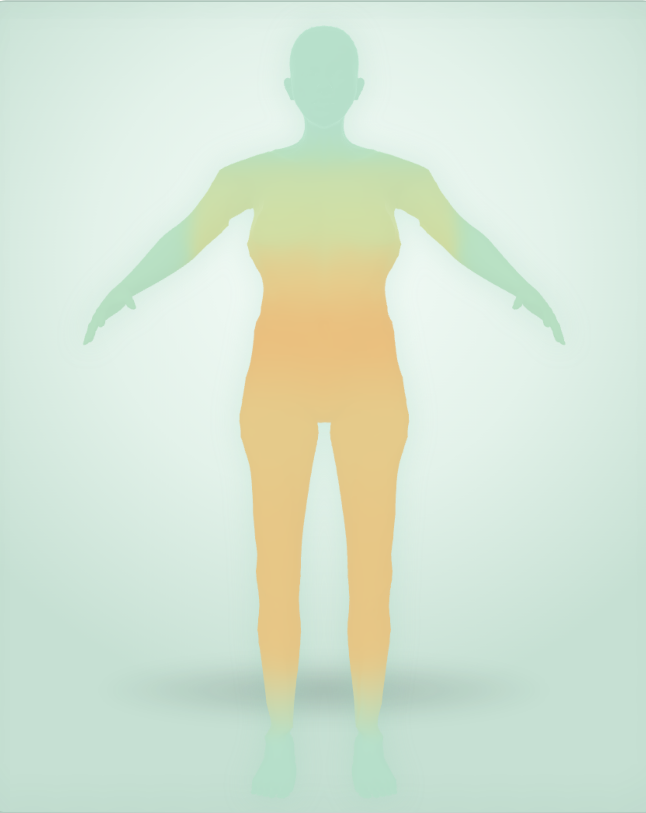
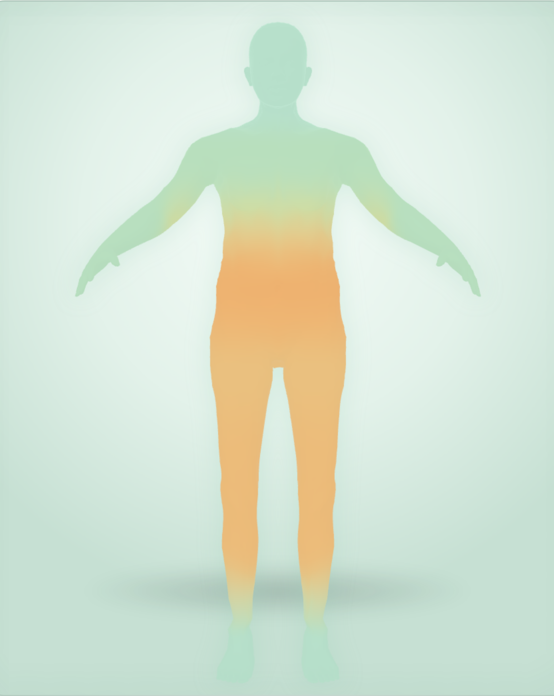
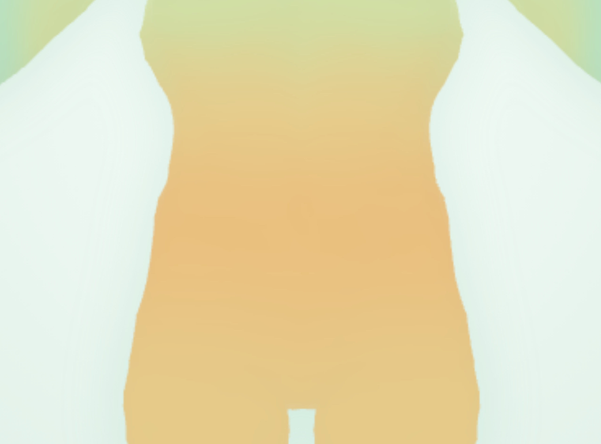
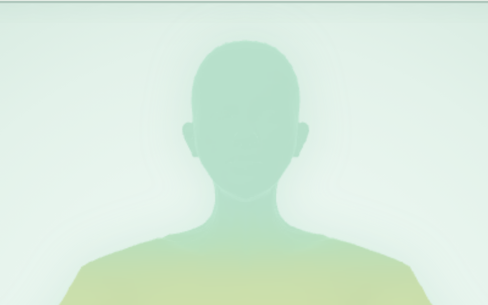

# OxiHuman 3D 模型网页

基于 HTML + Three.js + WASM 的 3D 人体模型展示页面，主入口为 oxihuman_index.html。

- GitHub 仓库：https://github.com/YOUR_USERNAME/YOUR_REPO
- 在线预览：https://YOUR_USERNAME.github.io/YOUR_REPO/oxihuman_index.html
- 评审权限：仓库为 Public，可直接 clone 或在线查看

## 效果展示

## 目录结构

- oxihuman_index.html：主入口页面
- index.html：GitHub Pages 根路径跳转页
- morph.js：形态变形逻辑
- ohpk.js：OHPK 数据包解析
- oxihuman_wasm.js / oxihuman_wasm_bg.js / oxihuman_wasm_bg.wasm：WASM 运行时
- oxihuman-core-v1.ohpk：核心数据包
- tree.json：模型骨骼树数据
- _body.bin：模型几何数据
- server.mjs：本地 HTTP 服务
- package.json：npm 配置
- vendor/：本地依赖库（Three.js、OrbitControls、ECharts）
- src/rust/：Rust 引擎源码
- screenshots/：README 效果图

## 本地运行

不要直接双击 HTML，file:// 协议会触发 CORS，WASM 和模型会加载失败。

在 PowerShell 中执行：

cd D:\Oxihuman
python -m http.server 8000

或使用仓库自带 Node 服务器：

npm install
node server.mjs

浏览器访问：

http://localhost:8000/oxihuman_index.html

## 环境与依赖

详见 ENVIRONMENT.md。

- 浏览器：Chrome 或 Edge 最新版，需支持 WebGL
- 本地服务：Python 3.8+ 或 Node.js 18+
- 前端库：Three.js、OrbitControls、ECharts，已本地化到 vendor/

## 部署

已通过 GitHub Pages 部署：

1. Settings 打开 Pages
2. Source 选择 Deploy from a branch
3. Branch 选择 main，目录选择 / (root)
4. 保存后等待 1 到 5 分钟

主文件为 oxihuman_index.html，仓库已提供 index.html 跳转页，访问根路径即可自动跳转。

## Git 提交历史

git log --oneline --graph --decorate --all

## License

仅用于项目评审与学习，模型版权归原作者所有。